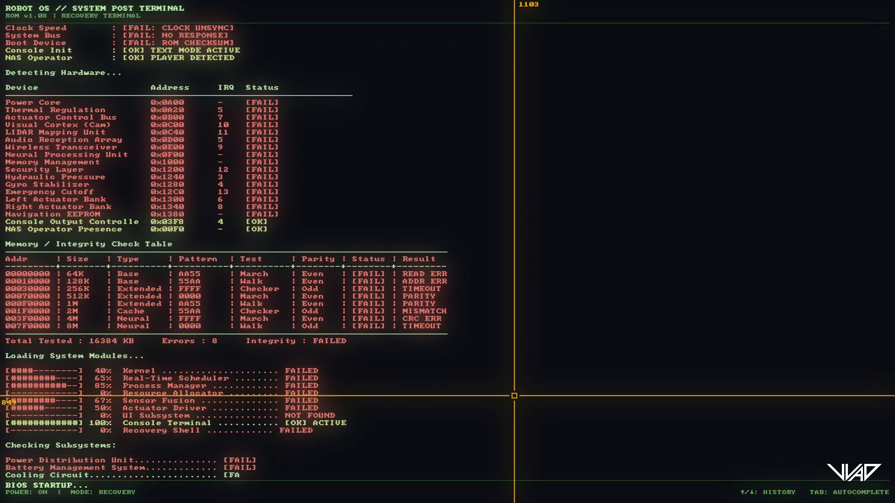
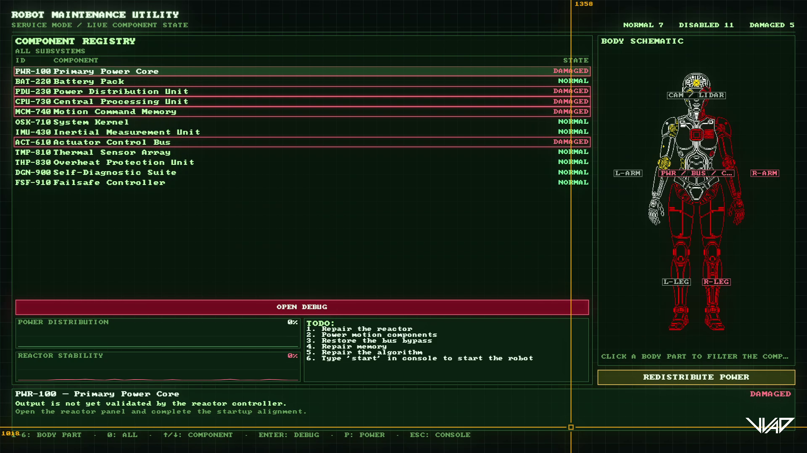
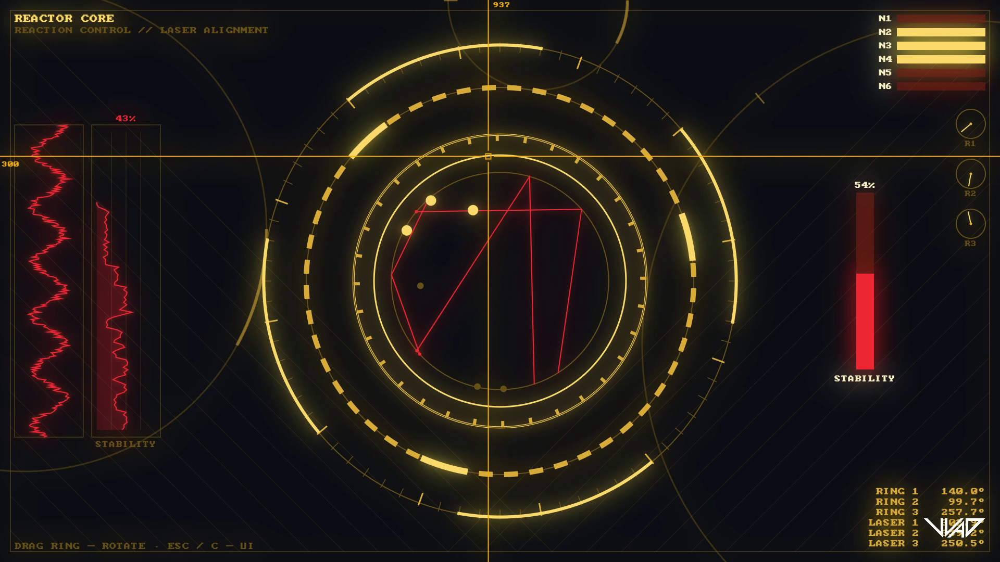
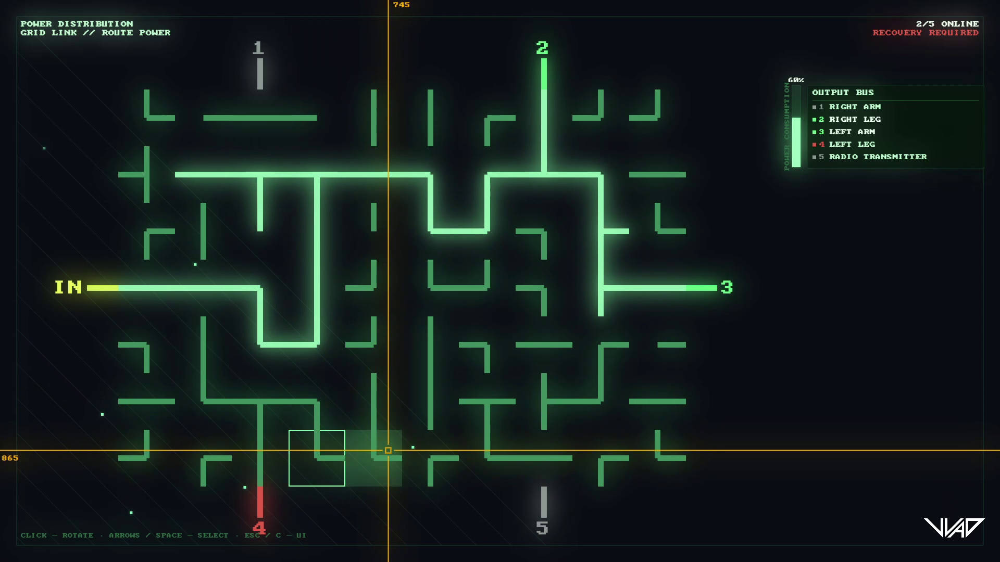
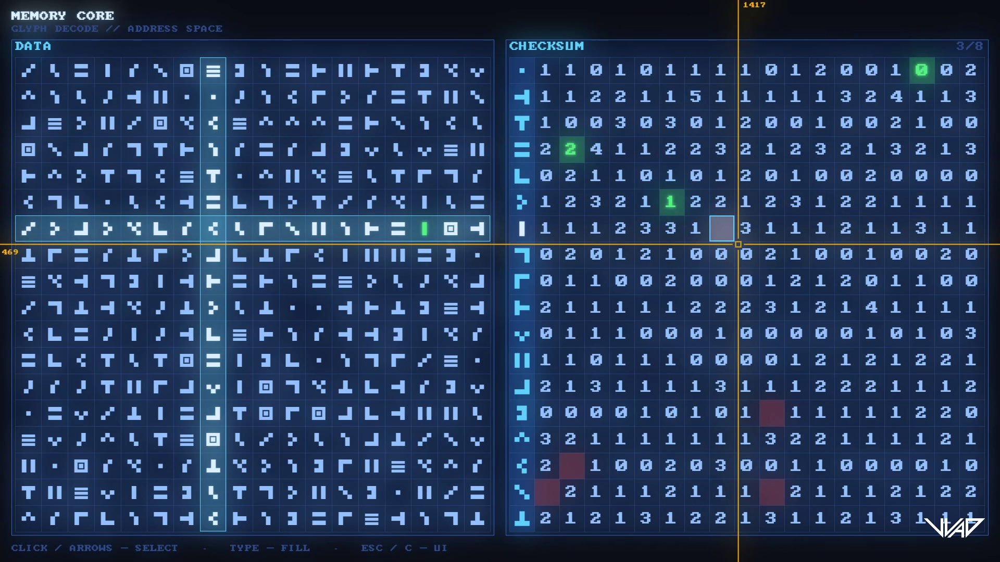
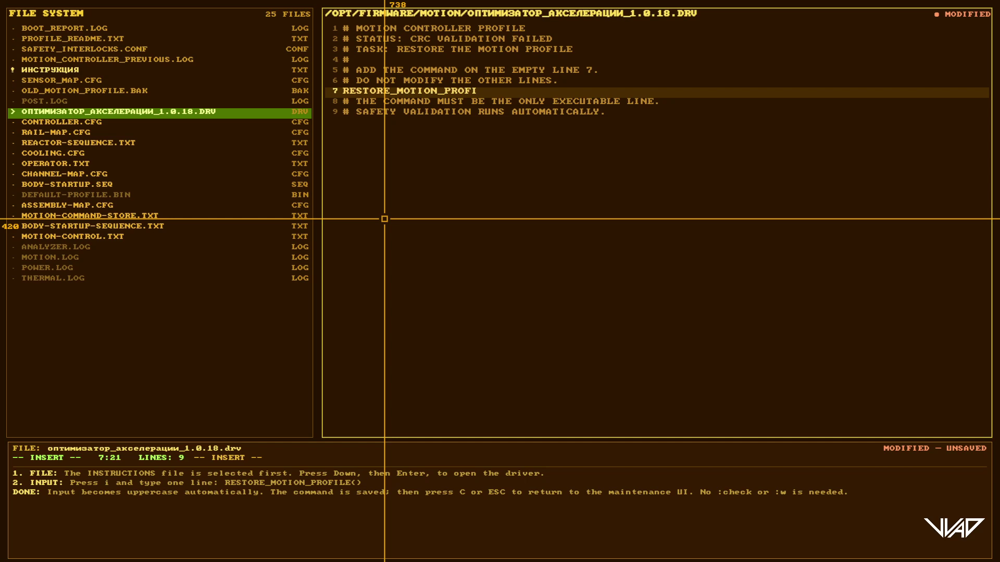
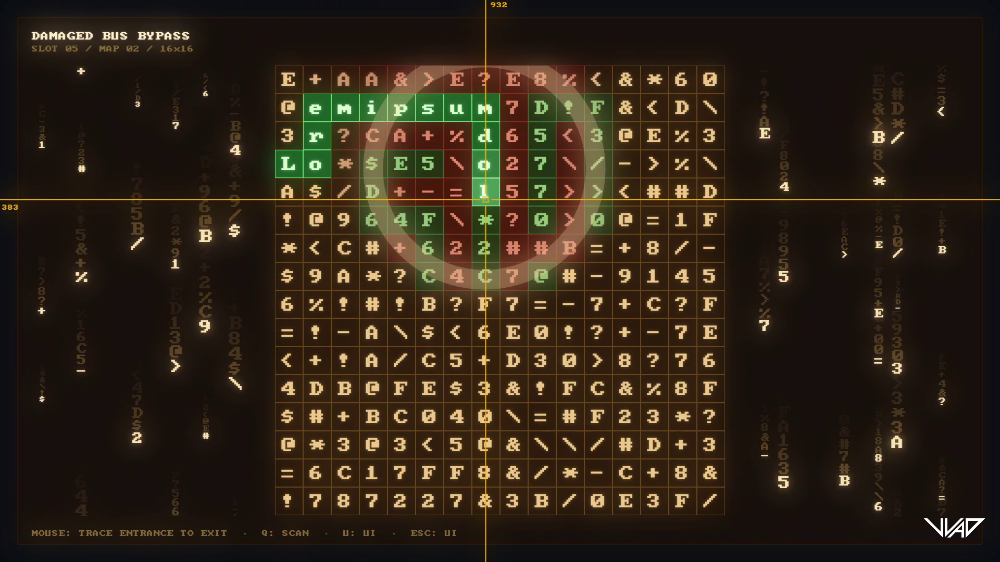

# Forgotten Gears

A 2D game built with TypeScript, HTML5 Canvas, and [Vite](https://vite.dev/).

You are an operator bringing a damaged robot back to life.

## Links

[](https://venediktvad.itch.io/forgottengears)
[](https://ldjam.com/events/ludum-dare/60/forgotten-gears)

<details>
<summary><b>Screenshots</b></summary>

| | | |
| :---: | :---: | :---: |
| [](screenshots/vlcsnap-2026-10-20-01h20m00s932.png) | [](screenshots/vlcsnap-2026-10-20-01h20m12s447.png) | [](screenshots/vlcsnap-2026-10-20-01h20m18s955.png) |
| [](screenshots/vlcsnap-2026-10-20-01h20m26s135.png) | [](screenshots/vlcsnap-2026-10-20-01h20m38s994.png) | [](screenshots/vlcsnap-2026-10-20-01h20m50s443.png) |
| [](screenshots/vlcsnap-2026-10-20-01h21m01s251.png) | | |

</details>

<details>
<summary><b>Requirements</b></summary>

- [Node.js](https://nodejs.org/) 20.19+ or 22.12+ (Vite 8 requirement)
- npm (bundled with Node.js)

</details>

<details>
<summary><b>Getting started</b></summary>

Install dependencies:

```bash
npm install
```

Start the dev server with hot reload:

```bash
npm run dev
```

Open the printed URL (default <http://localhost:5173>).

</details>

<details>
<summary><b>Project structure</b></summary>

```
index.html          # HTML shell with the <canvas>
public/             # Static assets copied as-is
src/
  main.ts           # Entry point, boots the game
  style.css         # Page/canvas styles
  game/
    Game.ts         # Game loop (update/render), resize handling
    Input.ts        # Keyboard input state
```

</details>
